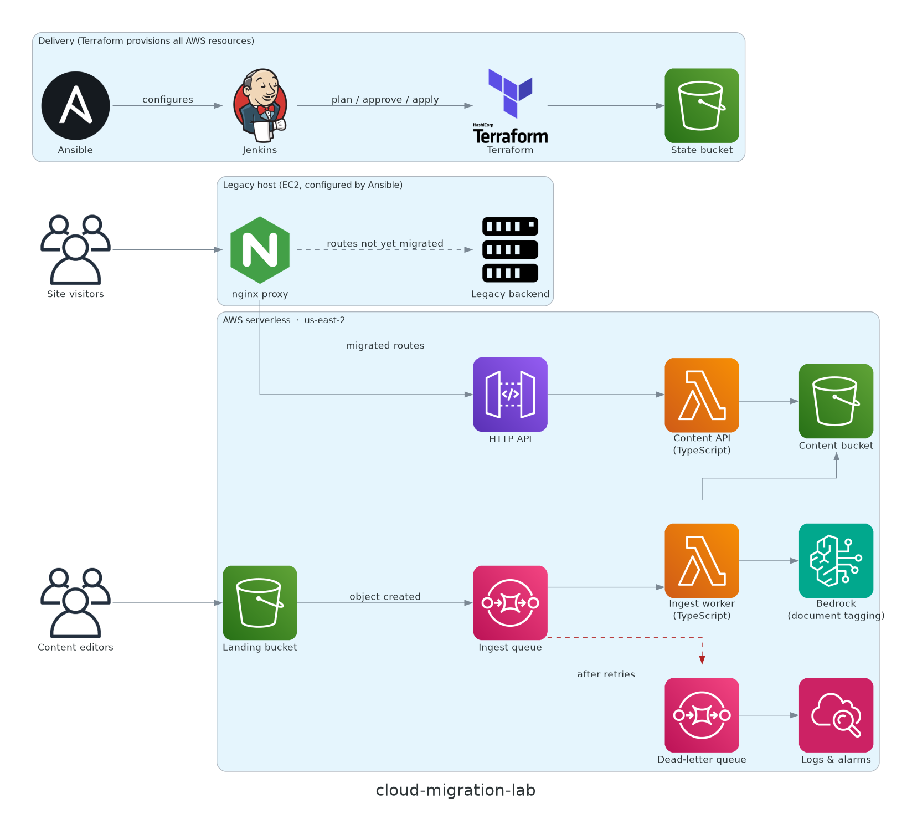

# cloud-migration-lab

Moving a legacy website backend off a single on-prem server and onto AWS serverless, one route at a time. All infrastructure is defined in Terraform.

The legacy server stays in front for the whole migration. Each route is re-pointed from the old backend to AWS at the existing nginx proxy, so every step can be reversed with a one-line change and users never see a different URL. DNS only moves once the old backend is serving nothing.

## Architecture



Generated from [`docs/architecture.py`](docs/architecture.py) with the [diagrams](https://diagrams.mingrammer.com) library.

## Components

| Component | Services | Purpose |
|---|---|---|
| Legacy host | EC2, nginx, Ansible | Stands in for the on-prem server and acts as the routing layer during migration |
| Content API | API Gateway, Lambda (TypeScript), S3 | Serves headless CMS content |
| Ingest pipeline | S3, SQS, Lambda (TypeScript) | Validates uploaded files and routes them to the correct S3 prefix; failures land in a dead-letter queue |
| Document tagging | Amazon Bedrock | Adds tags and summaries to ingested documents |
| Delivery | Jenkins, Ansible, Terraform | Test, plan, manual approval, apply |
| State | S3 | Versioned, encrypted, TLS-only, native locking |

## Security

- No root user and no long-lived access keys. All access uses short-lived role credentials.
- One least-privilege IAM role per function.
- All buckets private, encrypted at rest, TLS-only.
- Account-specific values stay out of the repository (partial backend configuration).

## Cost

- Serverless by default. No NAT gateways or load balancers.
- EC2 hosts are short-lived and destroyed after each session.
- Single region.

## Content API

`GET /api/content/{slug}` returns a page stored at `content/{slug}.json` in the content bucket.

```bash
curl https://<api-id>.execute-api.us-east-2.amazonaws.com/api/content/about
```

| Status | When |
|---|---|
| 200 | Page found (cached for 60 seconds) |
| 400 | Slug is not lowercase words separated by hyphens |
| 404 | No page with that slug |
| 500 | Storage error; details are logged, never returned |

Run the tests and build locally:

```bash
cd services/content-api
npm ci
npm test
npm run build   # also loads the bundle to catch runtime errors before deploy
```

## Repository layout

| Path | Contents |
|---|---|
| `bootstrap/` | S3 bucket for Terraform state, applied once per account |
| `docs/` | Architecture diagram and the code that generates it |
| `infra/content-api/` | Terraform for the content API: private bucket, least-privilege IAM role, Lambda, HTTP API |
| `services/content-api/` | TypeScript Lambda handler, unit tests and build script |

## Status

- [x] Terraform state backend
- [x] Content API
- [ ] Ingest pipeline
- [ ] Legacy host and route-by-route cutover
- [ ] Jenkins pipeline
- [ ] Document tagging
- [ ] DNS cutover plan
