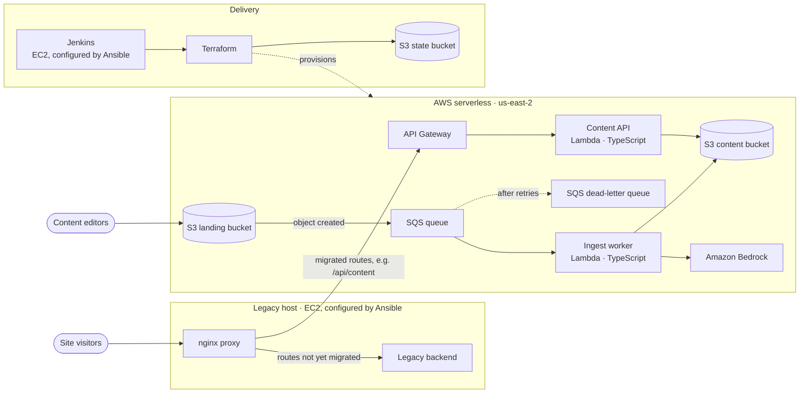

# cloud-migration-lab

Moving a legacy website backend off a single on-prem server and onto AWS serverless, one route at a time. All infrastructure is defined in Terraform.

The legacy server stays in front for the whole migration. Each route is re-pointed from the old backend to AWS at the existing nginx proxy, so every step can be reversed with a one-line change and users never see a different URL. DNS only moves once the old backend is serving nothing.

## Architecture

## Components

| Component | Services | Purpose |
|---|---|---|
| Legacy host | EC2, nginx, Ansible | Stands in for the on-prem server and acts as the routing layer during migration |
| Content API | API Gateway, Lambda (TypeScript), S3 | Serves headless CMS content |
| Ingest pipeline | S3, SQS, Lambda (TypeScript) | Validates uploaded files and routes them to the correct S3 prefix; failures land in a dead-letter queue |
| Document tagging | Amazon Bedrock | Adds tags and summaries to ingested documents |
| Delivery | Jenkins, Ansible, Terraform | Test, plan, manual approval, apply |
| State | S3 | Versioned, encrypted, TLS-only, native locking |

## Security

- No root user and no long-lived access keys. All access uses short-lived role credentials.
- One least-privilege IAM role per function.
- All buckets private, encrypted at rest, TLS-only.
- Account-specific values stay out of the repository (partial backend configuration).

## Cost

- Serverless by default. No NAT gateways or load balancers.
- EC2 hosts are short-lived and destroyed after each session.
- Single region.

## Repository layout

| Path | Contents |
|---|---|
| `bootstrap/` | S3 bucket for Terraform state, applied once per account |

## Status

- [x] Terraform state backend
- [ ] Content API
- [ ] Ingest pipeline
- [ ] Legacy host and route-by-route cutover
- [ ] Jenkins pipeline
- [ ] Document tagging
- [ ] DNS cutover plan
